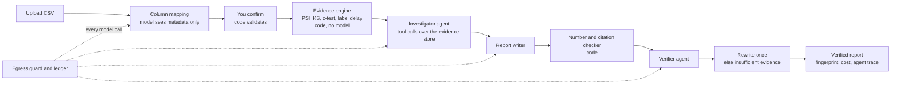

# TALO

**Audit your fraud, KYC and AML models without sending customer data anywhere.**

TALO is a model-audit workbench for banks and fintechs. Upload a model's decision log and TALO finds drift with
deterministic statistics, then uses Meta's Muse Spark to write an audit report in which every claim cites numbered
evidence and is checked by code and by a second agent. Raw rows never reach a model, and every outbound request is
recorded in an Egress Ledger you can inspect.

Built for the **Meta Global AI Developer Hackathon**, Indie Developer track, theme *Build for Your World*.

**Live demo:** <YOUR-RENDER-URL> &nbsp;·&nbsp; **3-minute video:** <YOUR-VIDEO-URL>

<!-- Screenshots: add four PNGs to docs/screenshots/ and uncomment.
| Audit console | Verified report | Red team | Egress Ledger |
|---|---|---|---|
|  |  |  |  |
-->

## The problem

Institutions that rely on automated fraud, KYC and AML models need to show how those models behave over time. Today
that means analysts hand-building drift reports. General-purpose LLM tools could write those reports faster, but they
create two new risks: customer data leaves the institution, and fluent text can state things the data does not support.

## What TALO does

- **Finds drift with code, not a model.** Population Stability Index on amounts, a Kolmogorov-Smirnov test on model
  scores, a per-channel two-proportion test on flagged rates, and label-delay shift. Each result becomes numbered
  evidence (`E-001`, ...), and a per-channel profile (`S-001`, ...) shows where drift sits and where it does not.
- **Writes a report that can be checked.** An investigator agent explores the evidence through tool calls, a writer
  drafts claims, a number and citation checker (code) rejects any figure that is not in the cited evidence, and a
  verifier agent attacks what remains. Unsupported claims are rewritten once, otherwise shown as *insufficient evidence*.
- **Keeps guesses labelled as guesses.** Possible causes appear in a separate "Hypotheses, not verified" section, each
  with a concrete next check an analyst can run.
- **Proves its own safety.** A red-team button injects ten fabricated claims and shows which ones the system rejects.
- **Shows exactly what left.** The Egress Ledger lists every model request with its full payload, tokens, latency and cost.
- **Is usable by a real team.** Accounts and organisations, tenant isolation, a column-mapping wizard for messy exports,
  a printable report with a SHA-256 fingerprint, and a private sandbox for anyone who clicks *Try the demo*.

## How it works



## How TALO uses Meta's models

All model calls go to **Muse Spark** through the Meta Model API's OpenAI-compatible chat completions endpoint, using a
Standard-tier model (default `muse-spark-1.3`). The code refuses any model ending in `-contributor`, because those may
train on prompts.

| Role | What it receives | What it returns |
|---|---|---|
| Schema mapper | Column names, types and aggregates | A confidence-scored mapping to the standard schema, validated by code and confirmed by the user |
| Investigator | The evidence store, one tool call at a time (`list_findings`, `get_evidence`) | Notes for the writer |
| Report writer | Evidence objects (findings and per-channel profiles) | Claims with evidence ids, plus unverified hypotheses |
| Verifier | Each claim and only the evidence it cites | Supported, partial or unsupported, with a reason |
| Rewriter | Rejected claims and their evidence | A narrower claim, or "insufficient" |

Every reply is requested as JSON, validated against a schema, and retried once with the validation error if it is invalid.

## Privacy model

Models receive column names, data types, null rates, `min / median / max` for numeric columns, value lists for
label-like columns with at most 20 distinct values (such as `channel`), and evidence objects. An egress guard blocks any
payload that contains a list of more than 100 items, a string longer than 300 characters, or a non-JSON type, so a row
dump cannot be sent by accident. Uploaded files are processed in memory and never written to disk; only findings, the
daily timeline and the per-channel table are stored. Identifiers such as account numbers never leave.

The "raw rows sent" counter reflects what the guard enforces. It does not claim that nothing derived from the data is
sent: aggregates and short category lists are, and the Ledger shows every one of them.

## Results

Measured on seeded synthetic data with known, injected problems (`python -m talo.evals`). Nothing is estimated except
cost. Raw output: [`backend/evals/results.json`](backend/evals/results.json).

**Drift detection (code only):** recall 100% and precision 100% across 3 datasets with injected issues, and 0 false
alarms across 3 clean datasets.

**Meta models compared**, 3 audits each, report plus red team:

| Measure | muse-spark-1.1 | muse-spark-1.2 | muse-spark-1.3 |
|---|---|---|---|
| Audits completed | 3 of 3 | 3 of 3 | 3 of 3 |
| Claims correct on the first draft | 80% | 75% | 65% |
| Fully supported after verification and rewrite | 100% | 95% | 100% |
| Left as "insufficient evidence" | 0% | 5% | 0% |
| Claims rewritten once | 20% | 20% | 35% |
| Fabricated claims rejected (10 per audit) | 30 of 30 | 30 of 30 | 30 of 30 |
| Average latency per model call | 5.8 s | 5.4 s | 8.2 s |
| Tokens per audit | 27,194 | 27,140 | 31,071 |
| Estimated cost per audit* | 8.6¢ | 8.5¢ | 10.0¢ |
| Failed calls | 0 of 30 | 0 of 30 | 0 of 30 |

\*At Muse Spark list prices of $1.25 per million input tokens and $4.25 per million output tokens; prices for earlier
versions may differ.

**Reading the results.** In this run the newest model needed the most corrections (65% correct on the first draft
against 80% for 1.1), and the pipeline brought all three to 95-100% supported. The checks, not the model version, are
what make the output trustworthy. Each audit is tested with 10 fabricated claims: the number checker stops 3, and the
verifier must reason about 7 (a flipped threshold, a reversed direction, the right number attributed to the wrong channel,
a cause the evidence cannot establish, and so on).

## Quickstart

Requires Python 3.11+ and Node 20+.

```bash
cp .env.example .env        # Windows: copy .env.example .env
# edit .env: set TALO_JWT_SECRET and MODEL_API_KEY

# terminal 1: API on http://localhost:8000
cd backend
python -m venv .venv
source .venv/bin/activate   # Windows: .venv\Scripts\activate
pip install -r requirements.txt
uvicorn talo.main:app --reload

# terminal 2: website on http://localhost:5173
cd frontend
npm install
npm run dev
```

Open http://localhost:5173 and click **Try the demo**. Generate a secret with
`python -c "import secrets; print(secrets.token_urlsafe(48))"`.

**A tour:** Try the demo, then New audit. Download the sample with different column names, upload it and let the model
map the columns. Run the audit, open it, click *Generate verified report*, then *Inject fabricated claims*, and finally
open the Egress Ledger and view a payload.

Without `MODEL_API_KEY` everything except column mapping, reports and the red team still works.

## Configuration

| Variable | Purpose | Default |
|---|---|---|
| `MODEL_API_KEY` | Meta Model API key | none |
| `META_MODEL` | Muse Spark model id (Standard tier only) | `muse-spark-1.3` |
| `META_BASE_URL` | Meta Model API base URL | `https://api.meta.ai/v1` |
| `TALO_JWT_SECRET` | Session signing secret | generated into `.talo_secret` for development |
| `TALO_DB_URL` | Database URL | `sqlite:///./talo.db` |
| `TALO_SECURE_COOKIES` | Set to `1` when served over HTTPS | `0` |
| `TALO_CORS_ORIGINS` | Allowed origins in development | `http://localhost:3000` |
| `TALO_PRICE_IN_PER_M`, `TALO_PRICE_OUT_PER_M` | Token prices used for cost estimates (USD per million) | `1.25`, `4.25` |
| `TALO_STATIC_DIR` | Built website to serve (set in the Docker image) | `static` |
| `TALO_EVALS_PATH` | Where evaluation results are written and read | `evals/results.json` |

`BASETEN_API_KEY`, `BASETEN_MODEL` and `BASETEN_BASE_URL` configure an optional open-weights adapter for Muse Spark
Open. It is included in the code but has not been run against a live endpoint, so no results are reported for it.

## Commands

Run from `backend/`.

```bash
python -m pytest -q                                   # backend tests
python -m talo.seed_report --mode cloud               # real report and red team for the demo workspace
python -m talo.evals --models muse-spark-1.1,muse-spark-1.2,muse-spark-1.3 --seeds 3   # compare models
```

The tests cover tenant isolation, CSRF, upload limits, the egress guard, the agent pipeline with a scripted model, the
red-team suite and the evaluation harness. The frontend type-checks with `npm run typecheck` in `frontend/`.

## Deployment

**One service (Render).** `render.yaml` and the root `Dockerfile` build the website and serve it with the API from one
container. Push the repository to GitHub, choose New, Blueprint on render.com, and paste `MODEL_API_KEY` when asked.
On the free plan the service sleeps after 15 minutes idle, and its disk is ephemeral, so accounts reset on redeploy
while the demo workspace is re-created at each start.

**Two services (Docker Compose).** `cp .env.example .env && docker compose up --build`, then open http://localhost:8080.

## API overview

| Area | Endpoints |
|---|---|
| Auth | `POST /api/auth/signup`, `/login`, `/demo`, `/logout`; `GET /api/me` |
| Audits | `GET, POST /api/audits`; `GET /api/audits/{id}`; `POST /api/audits/mapping-preview` |
| Reports | `GET, POST /api/audits/{id}/report`; `POST /api/audits/{id}/report/redteam` |
| Ledger | `GET /api/egress`; `GET /api/egress/{id}` |
| Other | `GET /api/settings`, `POST /api/settings/mode`, `GET /api/evals`, `GET /api/sample.csv`, `GET /api/health` |

Interactive docs are at `/docs` when running locally.

**Upload format.** A CSV with the columns `timestamp, channel, amount, model_score, decision_flagged, label_delay_days`
(or any column names, mapped in the wizard), at most 10 MB and 500,000 rows, at least 1,000 rows.

## Project structure

```
backend/talo/
  synth.py        seeded synthetic data with an injected-issue manifest
  evidence.py     drift detection, per-channel profile, daily timeline
  agents.py       investigator, writer, checker, verifier, rewriter, red team
  mapper.py       model-proposed column mapping, validated by code
  llm/            provider adapters, egress guard, ledger recording
  reports.py      report storage, cost metering, fingerprints
  api.py          FastAPI app: auth, organisations, audits, reports, ledger
  evals.py        evaluation harness
backend/tests/    backend test suite
backend/evals/    committed evaluation results
frontend/src/     Vite, React and TypeScript website
Dockerfile        single-service image;  docker-compose.yml: two-service setup;  render.yaml: Render blueprint
```

## Security

Passwords are hashed with argon2. Sessions use an httpOnly, SameSite cookie that expires after 8 hours, and state-changing
requests need a CSRF token. Failed logins are rate limited. Every record belongs to an organisation and every query is
scoped by it, which the tests verify. Uploads are limited by size, row count and content type and parsed defensively.
The demo sandbox is private per visitor, limited to 60 model calls, and limited to 20 new sandboxes per hour per address.

## Limitations

- Evaluated on synthetic data from one domain and a small number of audits per model. These results show the pipeline
  works as designed, not how it performs on a real institution's logs.
- The verifier is the same model family as the writer, so errors can be correlated. The red-team suite covers ten claim
  types, which is not every way a report can be wrong.
- Thresholds follow common conventions (for example PSI above 0.25) and are not tailored to any institution's policy.
- Numeric aggregates and short category lists are sent to the model. Institutions with stricter rules would need to
  tighten the guard.
- A report takes roughly 45 to 70 seconds and the page does not stream progress, only a live count of model calls.
- This is a hackathon project, not a regulatory certification or a substitute for model-risk governance.

## Roadmap

Native tool calling and schema-constrained output from the Meta Model API, per-agent reasoning effort to cut latency and
cost, auditing against an institution's own policy document, a converter for public mobile-money datasets, and
calibration and fairness checks.

## Built during the hackathon

Everything in this repository was written during the Meta Global AI Developer Hackathon. It uses only synthetic data.
Models: Muse Spark through the Meta Model API (`muse-spark-1.3`, with 1.1 and 1.2 evaluated for comparison).

## License

MIT. See [LICENSE](LICENSE).
